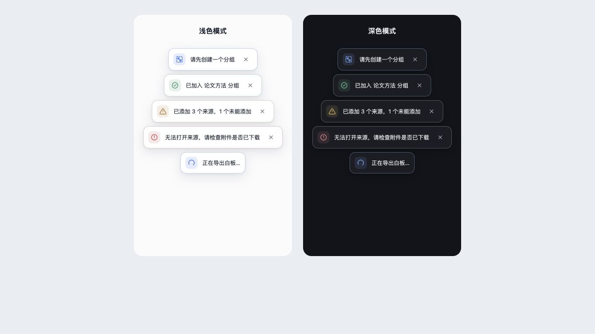

# Design System: Scholar Sketch

## Overview

**Creative North Star: "The Quiet Research Desk"**

Scholar Sketch is a compact, native-feeling writing surface for researchers working inside Zotero. Its interface should recede while the document remains legible, using a restrained neutral palette, thin structural borders, and one consistent icon vocabulary.

The editor is document-first, not an IDE or a dashboard. Live Preview uses a centered reading column; the toolbar and status bar align to the same horizontal rhythm. The UI should feel deliberate and calm, never like a collection of floating controls.

- Dense enough for frequent writing actions.
- System typography with strong Chinese and Latin fallback coverage.
- Light and dark themes use equivalent hierarchy, not merely inverted colors.

Document-editor layout rules apply to Markdown. [Research Canvas Cards](#research-canvas-cards) and [Canvas Notifications](#canvas-notifications) define the whiteboard's own components and feedback surfaces.

## Colors

The palette uses cool neutral surfaces and one blue accent reserved for links, focus, and primary context. Status colors communicate meaningful states and outcomes. Markdown save feedback uses the values below; whiteboard operation feedback uses the scoped [notification palette](#notification-states-and-icons).

### Primary

- **Research Blue** (`#2563eb`, dark `#60a5fa`): links, focus, and accent state. Do not use it as a decorative background across the editor.

### Neutral

- **Paper Canvas** (`#fbfbfc`): outer editor canvas in light mode.
- **Document Surface** (`#ffffff`): primary light writing surface.
- **Utility Surface** (`#f3f4f6`): toolbar hover and status-bar surface.
- **Graphite Text** (`#111827`): primary light-mode text.
- **Night Canvas** (`#12141a`) and **Night Surface** (`#1a1d24`): dark-mode background layers.

### Markdown Save Status

- **Saved Green** (`#059669`, dark `#34d399`): only for successfully saved state.
- **Pending Amber** (`#d97706`): only for unsaved or saving state.
- **Error Red** (`#dc2626`): only for save failure or destructive feedback.

## Typography

**Body Font:** `system-ui, -apple-system, "Segoe UI", "PingFang SC", "Hiragino Sans GB", "Microsoft YaHei", sans-serif`

**Label Font:** The body stack, at 12px and medium weight for toolbar controls and status details.

**Character:** Reading-oriented system sans typography. Live Preview uses 1.7 line height and a centered 48rem maximum text column. Source mode may use a monospace stack without changing the surrounding shell.

### Hierarchy

- **Document body** (14px, 400, 1.7): primary writing and reading content.
- **Toolbar label** (12px, 500, 1): tooltip and control label context only; buttons themselves are icon-first.
- **Status detail** (11px, 500): word and line counts, save status, and time. Use tabular numbers where time or counts appear.

## Elevation

Depth is primarily structural: separated surfaces use a one-pixel border and tonal contrast. The floating toolbar uses a restrained shadow to distinguish it from scrolling content, with a darker equivalent in dark mode. Keep document content flat; do not turn paragraphs into floating cards or add decorative shadows.

## Components

### Toolbar

In note tabs and standalone windows, the toolbar floats at the top center of the editor workspace, with 12px outer spacing. Its width follows its controls and is bounded by the workspace after sidebars take their space; it does not reserve a separate layout row. Keep functional groups separated by a one-pixel divider and use the existing full/grouped/compact layouts as the workspace narrows.

The floating shell does not intercept clicks outside the toolbelt. Its measured height supplies the initial content inset and scroll margin in the iframe and read-only preview, so the first line and navigation targets remain clear. Always-hide mode removes that inset; auto-hide keeps it stable while the toolbar fades to avoid moving the document. Do not translate or filter the toolbar container: its menus use viewport-based fixed positioning. The native item-pane editor keeps its compact inline toolbar.

The top toolbar setting offers Always show, Auto-hide, and Always hide. Auto-hide fades the toolbar in when the pointer reaches the editor's top edge and fades it out after the pointer leaves. Open menus and keyboard focus within the toolbar keep it visible. Respect reduced-motion preferences by disabling the fade. The bottom-bar action reveals an auto-hidden toolbar temporarily without changing the setting; in Always-hide mode it restores Always show. Existing hidden/visible choices remain intact until the user saves a mode: `markdownToolbarMode` is authoritative when valid, otherwise the legacy `markdownToolbarVisible` preference resolves to Hidden only when explicitly false. Only the new mode is written.

### Toolbar Buttons

- **Shape:** 32px square hit target, 7px radius, no resting border; regroup controls rather than scaling them on narrow windows.
- **Default:** transparent background with muted text color.
- **Hover:** `surface-muted` background with primary text color.
- **Icons:** 16px stroke icons; never scale directly from `devicePixelRatio`.
- **Ordering:** save, history, text structure, list/task controls, inline/content insertion, then a right-aligned horizontal more menu.

### More Menu

- **Surface:** a compact `max-content` menu (12–16rem) whose right edge aligns with the more button, with an 8px radius, one-pixel border, and restrained shadow.
- **Grouping:** do not render category headings; separate document, editing, export, and other actions with one-pixel dividers.
- **Submenus:** Mode expands an indented inline list with a check on the current mode. Settings remains a reserved submenu entry.
- **Unavailable actions:** every planned-but-unimplemented action gives immediate lightweight feedback instead of silently doing nothing.

### Editor Column

- **Live Preview:** 48rem maximum width, centered, with 28px inline and 20px top padding.
- **Source:** unconstrained document width and monospace text, while retaining the same surrounding shell.
- **List markers:** use an explicit high-contrast marker treatment in dark mode; do not rely on muted syntax opacity for list labels.

### Shortcut Settings

Use a compact Markdown / Whiteboard segmented radio group to switch shortcut
references. Both choices remain visible, use neutral theme surfaces, and provide
one Tab stop with arrow-key and Home/End navigation. On narrow settings panels,
move the group below the heading; stack its choices when the panel cannot fit
both labels. Display platform-specific bindings and label table-only actions.

### Status Bar

- **Layout:** left-aligned `words · lines`; right-aligned save state and time.
- **Padding:** 5px block and 28px inline, matching toolbar and document edges.
- **Saved state:** green check, local `HH:mm` time, and the text `自动保存已开启`.

## Do's and Don'ts

### Do:

- **Do** align the toolbar and rendered tables to the Live text boundaries inside the centered 48rem reading column.
- **Do** use icon-first controls with 36px targets and visible tooltips.
- **Do** keep interaction states restrained: a muted surface hover is enough for ordinary toolbar actions.
- **Do** preserve a clear, semantic save state in the status bar.
- **Do** verify dark mode contrast for small UI marks, especially list labels and status icons.

### Don't:

- **Don't** reintroduce branding, mode pills, or text status pills into the toolbar.
- **Don't** use blue filled buttons for routine editor controls; the accent is for focus and semantic emphasis.
- **Don't** put controls in rounded group containers or use decorative glass effects.
- **Don't** add floating cards, oversized shadows, gradients, or marketing-style composition to the editor shell.
- **Don't** let status-bar content sit closer to the window edge than the toolbar or Live Preview content.

## Research Canvas Cards

Academic cards share an 8px radius, 12px vertical / 14px horizontal padding,
theme-aware neutral surfaces, and a compact icon-and-label header. Notes carry a
persistent card type: Note, Question, Viewpoint, Evidence, or Summary. The header
shows the type and an optional short title. Type-specific prompts guide empty
cards and editors without becoming saved body text. Built-in starting styles
use a neutral Note, amber Question with rounded dashed edges, green Viewpoint
with a stronger outline, blue Evidence with square corners, and lavender Summary.
Each has a distinct icon, written label, and equivalent low-luminance dark palette.

The properties panel always shows the selected card's type. Changing type keeps
its title, body, source, dimensions, and explicit style overrides. Untouched default colors and corners follow the new type. Custom templates live in a
collapsed section and remain one-time reusable starting points; they are not
ongoing bindings. Old Question/Claim badges are recognized as types until the
user edits the card, while custom titles remain intact.

Literature prioritizes its title, citation, and a small tag set. Quote uses a
structural quotation rule inside its body, with provenance in the footer.
Footers render only when there is information to show. Existing node sizes and
user-defined styles remain authoritative. Long note bodies, excerpts, comments,
and attachment previews scroll within the card while headers and provenance stay
visible. Wheel gestures over the body never zoom the canvas, including at either
scroll boundary. Blank canvas still supports zooming, and Space temporarily pans
over cards. Center and bottom alignment fall back to the top when content
overflows so the first line remains reachable.

Selection uses a crisp theme-aware outline instead of a blue glow. Card handles
remain measurable and interactive, but become visible on hover, selection,
keyboard focus, or while a connection is being drawn. Touch devices retain
visible handles. The shared selection toolbar and existing editing flows remain
the action surfaces.

The **View annotations** action and annotation-list empty state share a transparent
document icon with a flat yellow-green highlight band. The document outline follows
`currentColor`; the band and its dark text mark retain their colors in both themes.
The band identifies the annotation feature, not a selected annotation type or a
successful operation. Keep the toolbar icon at 16px and the empty-state icon at 24px.

Cards and shapes expose four independently named connection points. Every side can start or receive a connection, and the chosen sides persist when moving cards, undoing, or reloading. Connection previews and completed edges use the same Bezier curves. Handles have a larger invisible hit area and accent feedback when a target snaps. Hovering or selecting a line reveals draggable endpoints; a successful reconnection preserves its identity, label, relation, and styling in one undoable change. Dropping a reconnection on empty space retains the original line. JSON Canvas import/export carries the standard `fromSide` and `toSide` fields, and SVG export uses the same sides and curve style. PNG export omits the endpoint controls and selection emphasis.

Color controls open compact popovers with six color families and three shades.
Fill and outline palettes keep matching columns, with lighter fills and darker
outlines first in light mode, reversed for dark mode. Backgrounds offer a separate
transparent option. Restore default clears explicit color overrides so card types
and themes remain authoritative. Custom color controls stay collapsed until
requested, then expose react-colorful and a Hex field. Text colors use the same
picker and retain an opacity control. Opening or expanding a picker never changes
the toolbar's dimensions or writes a color to the document.

Note editing aligns to the card body using the same padding and header tokens,
scaled with the canvas zoom. The input grows within the available body space
and scrolls for longer content. Enter inserts a newline; Ctrl/Cmd+Enter commits,
Escape cancels the current edit, and input-method composition never commits an
edit. Basic shape labels retain their existing Enter-to-commit behavior.

## Canvas Notifications

The whiteboard uses lightweight floating notices, independent of the Markdown status bar. Keep the canvas as the primary surface: a notice explains an outcome or a missing prerequisite without opening an empty dialog, covering the canvas with a backdrop, or taking focus. Use a dialog when the user actually needs to choose or confirm something. For example, **Join group** shows an informational notice when there are no groups and opens the existing picker when groups are available.

The following reference renders the production `Notice` component with illustrative messages, showing light and dark themes. It is a component comparison, not an example of five notifications that should always appear together.

### Notification States and Icons

| State      | Default icon             | Light accent   | Dark accent    | Meaning and current examples                                                                                          |
| ---------- | ------------------------ | -------------- | -------------- | --------------------------------------------------------------------------------------------------------------------- |
| `info`     | Circled information mark | `#2563eb`      | `#79adff`      | Guidance or a prerequisite; no group available.                                                                       |
| `success`  | Circled check            | `#198754`      | `#68c694`      | Confirmed success; sources added, group joined, style copied.                                                         |
| `warning`  | Warning triangle         | `#a56a11`      | `#e5b65b`      | Partial success or unsupported input; some sources or annotations could not be loaded, unsupported or malformed drop. |
| `error`    | Circled exclamation mark | `#c43d45`      | `#f08b8b`      | Failed operation; source unavailable, file operation or PNG rendering failure.                                        |
| `progress` | Open circular spinner    | Same as `info` | Same as `info` | Work still running; PNG rendering. Never use a success icon before completion.                                        |

A contextual icon may replace the default without changing the state's meaning: the missing-group notice uses the group icon, and active format painting uses the paint roller. Icons use `currentColor`; do not introduce emoji or multicolor illustrations.

For an acquisition summary, zero failures with at least one success is `success`; mixed successes and failures is `warning`; failures without any success is `error`; zero results is `info`. The message must state the actual outcome. A request being sent is not proof that a file has been saved or exported.

### Surface, Spacing, and Motion

| Element           | Specification                                                                                                                 |
| ----------------- | ----------------------------------------------------------------------------------------------------------------------------- |
| Surface           | Opaque theme surface with primary text color; no full-color fill, gradient, or backdrop blur.                                 |
| Outline and shape | 1px border, mixing 16% state accent into the theme border; 12px radius.                                                       |
| Content           | 9px vertical / 10px horizontal padding; 10px gaps; 12px system text with 1.5 line height.                                     |
| Icon              | 16px line icon within an explicit 26 × 26px box; 8px radius, 12% accent background.                                           |
| Close button      | 28 × 28px target, 16px cross, 8px radius; muted default color, theme hover surface, visible focus outline.                    |
| Elevation         | Light: `0 2px 5px rgba(15,23,42,.04), 0 8px 24px rgba(15,23,42,.10)`; dark: equivalent offsets with black at `.10` and `.22`. |
| Entry             | 160ms ease-out fade, settling from 4px above; no bounce or scale effect.                                                      |
| Progress          | Only the progress icon rotates, once per second; the notice stays still.                                                      |

`prefers-reduced-motion: reduce` disables both entry and spinner animation. There is currently no exit animation. Keep the icon box's explicit width as well as its non-shrinking flex behavior: relying only on `flex-basis` can underestimate intrinsic width and unnecessarily wrap short Chinese text.

Normal notices sit below the top toolbar, 72px from the canvas top. The stack is centered, at most 520px wide, with at least 16px side clearance and 8px between notices. Each notice uses its content width up to that limit. Long messages wrap; the icon and close button remain visible. Stack gaps pass pointer input through to the canvas, while notices and their controls remain interactive.

Format painter instructions and style-copy feedback stay centered 16px from the bottom, at most 520px wide with 48px side clearance. They use the same surface and state styling.

### Lifecycle and Accessibility

`Notice` is a presentation component. Its caller owns the operation, message, dismissal, and timer. Reuse it for new whiteboard feedback instead of creating a separate styled popup or notification store.

| Current consumer                                                                   | Placement | Dismissal                                                                                                                                                                                                          |
| ---------------------------------------------------------------------------------- | --------- | ------------------------------------------------------------------------------------------------------------------------------------------------------------------------------------------------------------------ |
| `CanvasNoticeRegion`: source/import/annotation feedback and missing-group guidance | Top stack | Manual close or 8 seconds; replacing the notice restarts its timer and cleans up the previous one.                                                                                                                 |
| Group-joined feedback                                                              | Top stack | 3 seconds; no close button.                                                                                                                                                                                        |
| PNG rendering                                                                      | Top stack | Progress ends with rendering/dispatch to the host; no close button while busy. Rendering errors remain until dismissed or replaced by a later export state. This is not confirmation of host file-save completion. |
| File-operation errors                                                              | Top stack | Manual close or replacement by another file error; no automatic expiry.                                                                                                                                            |
| Active format painter / copied-style feedback                                      | Bottom    | Active instructions remain until painting ends or is cancelled; copied-style feedback lasts 2.2 seconds. Active painting takes precedence in this slot.                                                            |

The top stack renders the existing export, canvas, file, and group feedback slots in that order. It is not a severity-sorted queue or notification history. A new `canvasNotice` replaces the previous one. Hovering or focusing a notice does not pause its timer.

Messages default to `role="status"` with polite announcements. File errors and PNG rendering errors explicitly use `role="alert"` with assertive announcements; the other canvas errors retain polite announcements. Announce the whole message with `aria-atomic="true"`. Icons are decorative (`aria-hidden`); state and outcome must remain understandable from the text. Close controls have localized accessible names and support mouse, Enter, and Space. Showing a notification does not move keyboard focus; cancelling the format painter returns focus to the canvas.

### Implementation and Review References

- [Notice component](packages/whiteboard/src/chrome/Notice.tsx): shared presentation, icons, close control, and announcement semantics.
- [Whiteboard application](packages/whiteboard/src/whiteboard/app.tsx): state mapping, localized messages, stacking, and operation lifecycles; [board CSS](packages/whiteboard/src/whiteboard/board.css): authoritative visual values and reduced-motion rules.
- [Notice DOM tests](test/whiteboard-annotation-notice-dom.test.ts), [workflow tests](test/whiteboard-workflow-dom.test.ts), and [format painter tests](test/whiteboard-format-painter-dom.test.ts): state meaning, dismissal, timer cleanup, and canvas interaction.
- [Whiteboard page](addon/content/whiteboard/index.html) and [bootstrap tests](test/whiteboard-bootstrap.test.ts): styles and scripts use the same editor-mount cache key so a reload does not combine new markup with old styles.

When extending this component, check both themes, short Chinese text, long messages in a narrow container, simultaneous notices, keyboard dismissal, and reduced-motion behavior. Use production components for previews. Browser layout checks do not substitute for native Zotero validation of host-dependent operations.

## Table Editing

The toolbar table control opens an anchored `8 x 8` grid. Hovering previews a contiguous rectangle and reports `columns x rows`; clicking inserts a valid GFM table with the first header cell selected. Row count describes visible table rows and excludes the Markdown delimiter line.

In Live mode, GFM tables remain a restrained rendered grid with shared column widths, a tinted header, one-pixel borders, and Markdown alignment markers respected. Clicking a cell activates only that cell: it receives a subtle focus background and shows its local Markdown source in place, while the row and all other cells remain rendered. The delimiter line stays collapsed throughout Live mode. CodeMirror remains the only document authority; cell input replaces only the exact cell content range.

Table borders use the same `34px` left and `30px` right insets as Live prose instead of extending to the outer reading-column edges.

The active table cell uses single-click activation with no input border. `Enter`, `Escape`, or a click outside the table commits and exits cell editing. `Tab` and `Shift+Tab` commit and move between logical cells; Tab from the final cell appends a body row. Right-click keeps the structural table menu available, and Source mode continues to expose normal Markdown without Live cell widgets.

Writable Live tables expose transient edge actions: hovering any right-gutter segment reveals one continuous table-height rail for appending a final column, while hovering the visually transparent bottom gutter reveals the action for appending a final row. The controls are real focusable buttons, remain outside table Grid tracks, and never activate cell editing. Rendered cells carry stable table, row, and column identity so newly appended empty cells receive input without falling back to an adjacent source position.

- `Tab` moves to the next logical cell.
- `Shift+Tab` moves to the previous logical cell.
- `Tab` in the final cell appends a new empty row and moves into its first cell.
- Light and dark themes use the same geometry and differ only in semantic surface and border tokens.

The table context menu is shared by Live and Source modes. It appears only when the pointer resolves to a logical GFM table cell; otherwise the native Zotero context menu remains available. Keep row, column, and alignment commands in stable groups separated by one-pixel dividers, without visible group headings.

- The header is fixed and cannot be deleted or moved.
- A table retains at least one column and its header/delimiter structure.
- Boundary moves and deletion of the final column remain visible but disabled.
- The current column alignment is marked with a restrained accent check.
- Every successful structural command replaces the table in one CodeMirror transaction so one undo restores the previous table.
- Context menus use compact 32px rows, an 8px radius, theme-aware surfaces, and viewport-clamped fixed positioning.

Markdown and Canvas expose “Open in standalone window” in their More menus and attachment context menus. Standalone editors expose “Return to Zotero tab” in the same position. These are nonmodal, resizable windows for multi-monitor work. Canvas keeps one editing surface per attachment; transfers and window closes save before disposing the source, and failed transfers retain the original editor.

## Image Sizing

Clicking an image in Live mode reveals a thin selection outline, four corner handles, and a compact floating toolbar. Dragging preserves aspect ratio and previews locally; releasing writes one undoable document change. Escape cancels an in-progress drag. The toolbar offers Small (240px), Medium (480px), Large (720px), Auto, a numeric width, and View original. Controls follow the selected occurrence, fit within the viewport, and use the editor's menu tokens in both themes. Keyboard users can focus an image, press Enter to reach the toolbar, or use arrow keys on a handle (Shift increases the step).

Each occurrence stores its display width as a standard HTML image tag inside Markdown. Live rendering, reading preview, HTML export, image import, and asset cleanup recognize these references without enabling arbitrary HTML. Images retain their aspect ratio and fit the reading column when the window narrows. Original attachment bytes remain unchanged. Reading preview opens images in a temporary modal with Auto and 100% views; viewing never changes the document.
