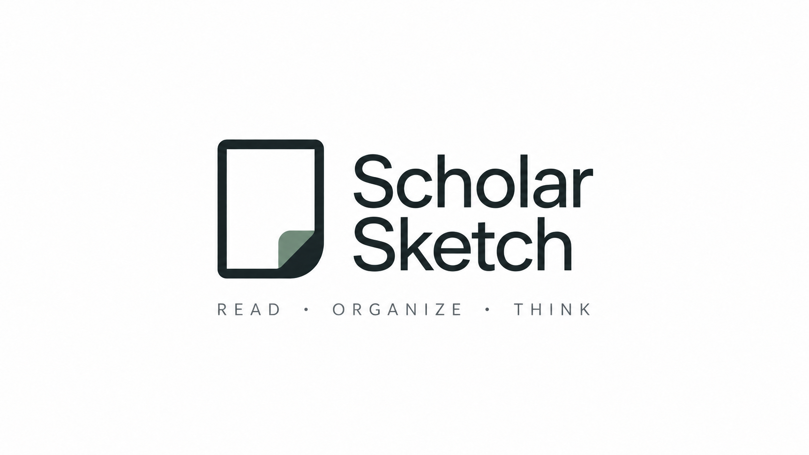
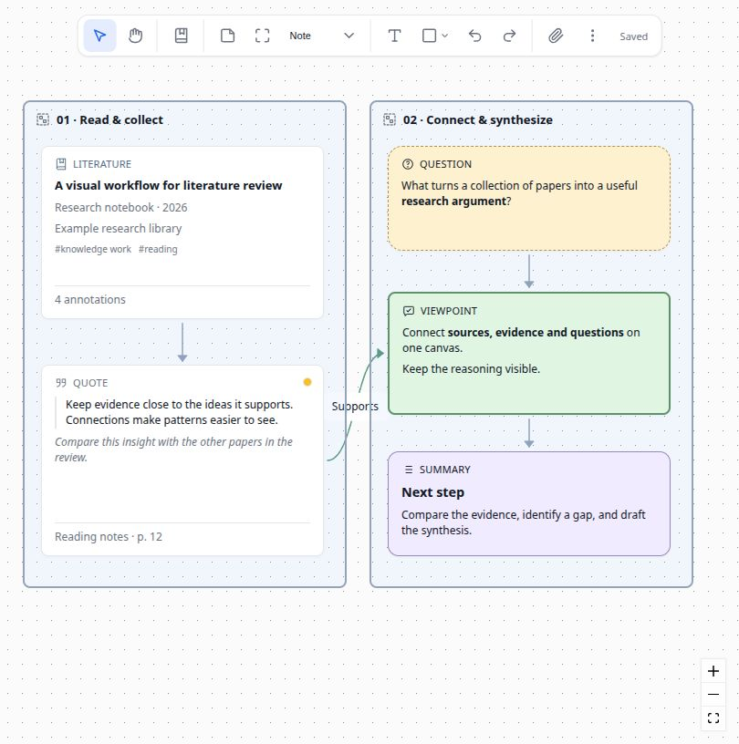
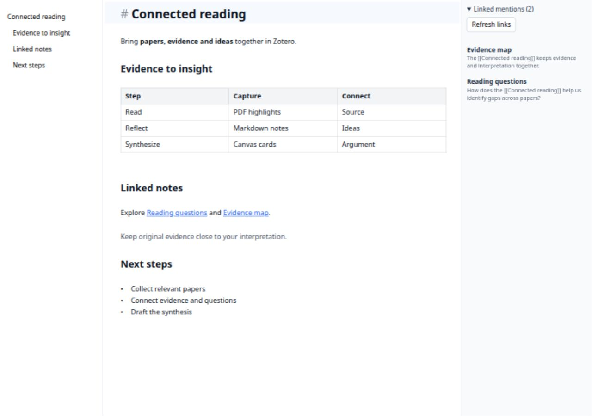
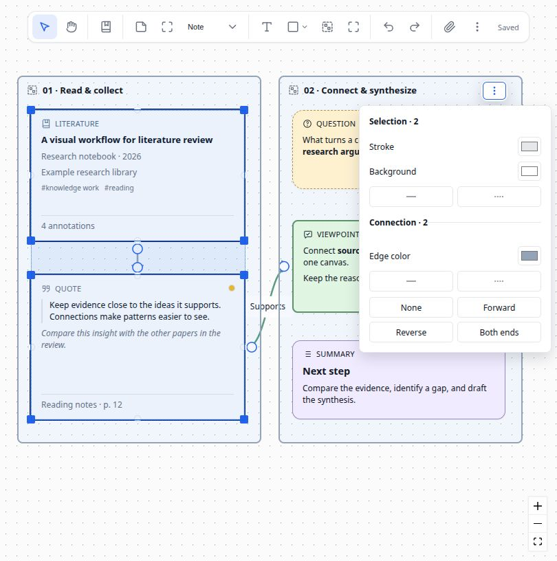

<p align="center">
  
</p>

<h1 align="center">Scholar Sketch</h1>

<p align="center"><strong>Markdown &amp; Whiteboard for Zotero</strong></p>

<p align="center">Zotero 中的 Markdown 编辑器与可视化白板</p>

<p align="center">
  <a href="https://www.zotero.org"></a>
  <a href="https://github.com/l0o0/scholar-sketch/releases"></a>
  <a href="../LICENSE"></a>
</p>

Scholar Sketch 为 Zotero 扩展 Markdown 笔记与可视化白板，让文献、PDF 注释和想法在同一工作空间中连接起来。

[English](../README.md) | [简体中文](README-zhCN.md) · [下载安装](https://github.com/l0o0/scholar-sketch/releases/latest)

## 功能

- **Markdown 编辑**：Live 即时预览、源码编辑与阅读预览，支持表格、图片、公式和脚注。
- **MD 流程图**：使用 Mermaid 在笔记中编写流程图、时序图和思维导图，支持实时预览、深浅主题及 HTML/PDF 导出。
- **双链笔记**：`[[笔记]]` 链接、目录、反向链接侧栏与文库全文搜索。
- **研究白板**：组织文献、注释、笔记和附件，通过分组与连线梳理想法，支持批量样式和自动布局。
- **Zotero 联动**：将文献拖入白板，浏览 PDF 注释，或从文字批注生成 Markdown 笔记。
- **便携文件**：使用 `.md` 与 JSON Canvas `.canvas` 格式；笔记可连同图片导出到 Obsidian 等工具，白板可导出 PNG、SVG 或 Markdown。
- **保存与恢复**：自动保存、本地历史与文件冲突检查，支持标签页和独立窗口。

## 安装

支持 **Zotero 9 / 10 / 11 桌面版**。

1. 从 [Releases](https://github.com/l0o0/scholar-sketch/releases/latest) 下载 `scholarsketch-v{version}.xpi`。
2. 在 Zotero 中打开 **工具 → 插件 → 齿轮 → 从文件安装插件…**，选择下载的文件。

## 界面预览

**研究白板：连接文献、注释与想法。**



**Markdown：实时编辑与双链引用。**



<details>
<summary>批量调整卡片和连线样式</summary>



</details>

## 快速开始

- **写笔记**：点击工具栏的 **Scholar Sketch** 按钮 → **新建 Markdown 笔记…**。先选中文献可创建其附属笔记；取消选择则在当前文库或分类下创建独立笔记。之后双击 `.md` 附件即可继续编辑，输入 `[[` 可链接其他笔记。
- **引用文献**：输入 `[[` 后按标题检索，候选列表显示 Zotero 条目类型图标，并可切换 **全部**、**常规条目**、**笔记/附件**、**已打开**。其中“已打开”包含当前 Zotero 窗口所有已打开标签页中的附件及其父条目。Tab 立即循环切换分类，Shift+Tab 反向切换，↑/↓ 选择条目，Enter 插入，Esc 关闭弹窗；切换分类后仍可直接继续输入。
- **建白板**：点击工具栏的 **Scholar Sketch** 按钮 → **新建白板…**，拖入文献、添加卡片并连接想法。按住 **空格** 拖动可移动画布。
- **复用样式**：选中卡片或图形，点击 **格式刷** 后再点击目标；双击格式刷可连续使用，按 **Esc** 退出。右键菜单也支持 **复制样式** 和 **粘贴样式**，多选粘贴可一次撤销，并保留目标的内容、文献引用和尺寸。
- **整理分类或回到最近白板**：在同一工具栏菜单的分隔线下选择 **从分类新建白板…** 或 **最近打开的白板**。
- **试用示例**：选择 **帮助 → Scholar Sketch：创建示例白板**。

存储附件可随 Zotero 文件同步；链接附件需自行同步。本地历史仅保存在当前设备。

### 在 MD 笔记中绘制流程图

直接在 `.md` 笔记中用 Mermaid 描述节点和连接，即可生成流程图、时序图或思维导图，适合记录研究步骤、实验流程和知识结构。图表源码保存在笔记中，可随时修改，无需先绘图再插入图片。

将下面的代码块粘贴到笔记中，即可创建一个从阅读文献到连接想法的流程图：

````markdown

````

- **查看与编辑**：在实时预览中将光标移出代码块即可显示图形，点击图形可重新编辑源码；阅读预览也会显示图形，源码模式则保留代码。
- **主题与导出**：图表适配浅色和深色主题，导出 HTML/PDF 时会嵌入图形。
- **离线使用**：渲染器随插件提供，按需加载，无需联网。语法错误或图表过于复杂时，会保留源码并显示提示。

## 文档

- [双链与导出](../docs/obsidian-links.md)
- [保存与历史恢复](../docs/file-safety.md)
- [功能使用说明](../docs/markdown-canvas-release-features.md)

<details>
<summary>开发与插件集成</summary>

```bash
pnpm install
cp .env.example .env  # 配置 Zotero 开发环境
pnpm start           # 构建并启动 Zotero
pnpm run build       # 生成 XPI
```

[浏览器测试](../docs/fake-zotero.md) · [Markdown API](../docs/markdown-api.md) · [Canvas API](../docs/canvas-api.md)

</details>

欢迎通过 [Issues](https://github.com/l0o0/scholar-sketch/issues) 反馈问题或提交 PR。

基于 [Zotero Plugin Template](https://github.com/windingwind/zotero-plugin-template) 与 [markdown-it](https://github.com/markdown-it/markdown-it) 构建。

[AGPL-3.0-or-later](../LICENSE)
