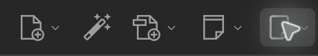
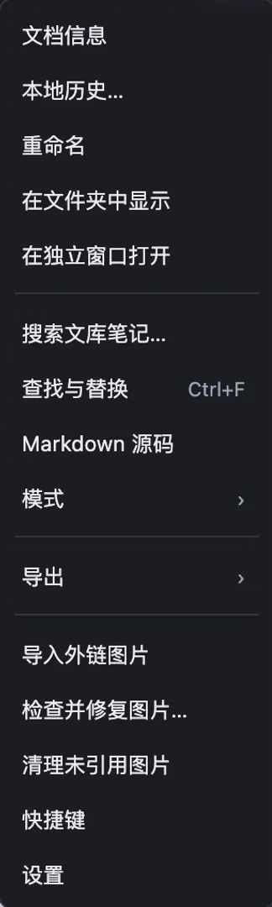
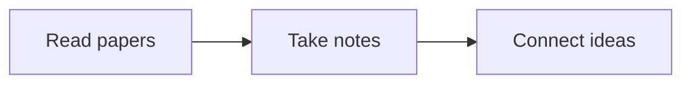
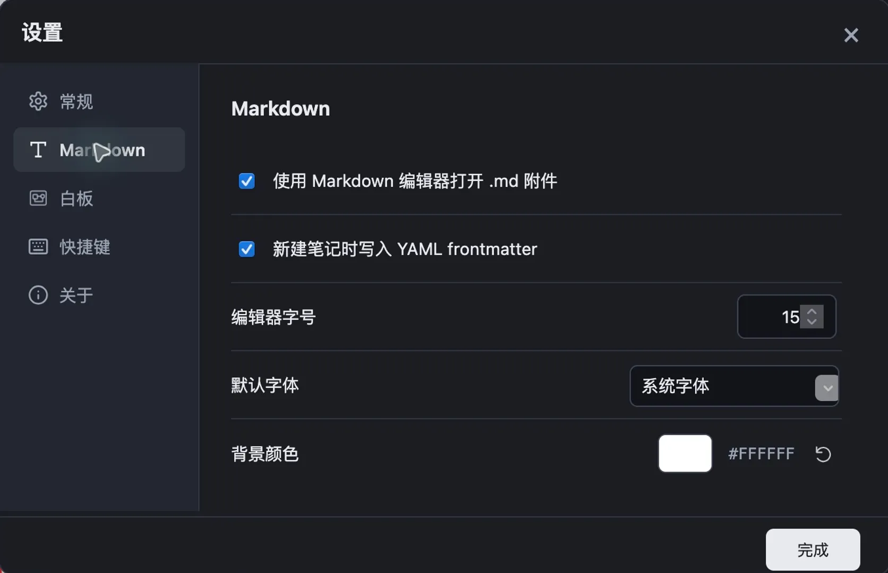
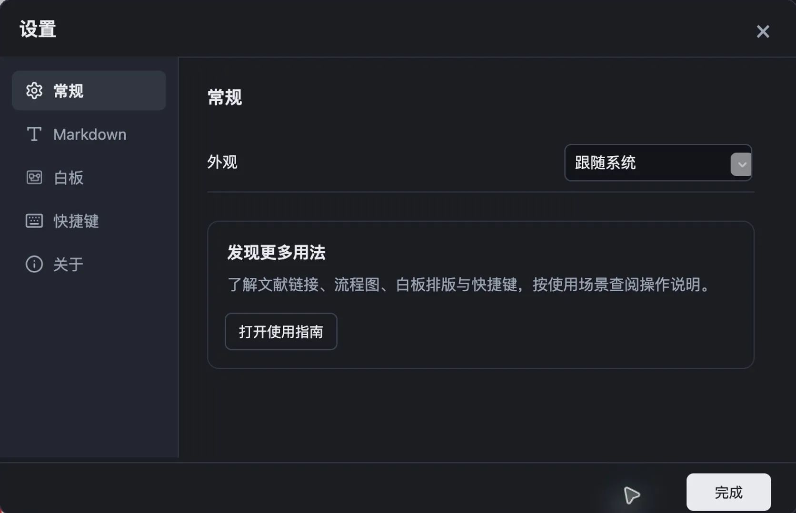

# Scholar Sketch

[English](user-guide.en.md) | [简体中文](user-guide.md)

Scholar Sketch adds Markdown notes and visual whiteboards to Zotero. Write notes while reading papers, then bring papers, annotations, and ideas onto a whiteboard. Use groups and connections to organize your thinking.

- Project: [Scholar Sketch](https://github.com/l0o0/scholar-sketch)
- Download: [Latest release](https://github.com/l0o0/scholar-sketch/releases/latest)
- Report a problem: [GitHub Issues](https://github.com/l0o0/scholar-sketch/issues)

## Install the plugin

The current version supports Zotero 9, 10, and 11 for desktop.

1. Download the `.xpi` file from the latest release page.
2. In Zotero, open **Tools → Plugins**.
3. Click the gear button, choose **Install Plugin From File…**, and select the downloaded `.xpi` file.

After installation, a Scholar Sketch button appears in the toolbar above your Zotero library. Hover over it to see **Scholar Sketch: New Markdown Note or Whiteboard**.

The screenshots in this guide use the Chinese interface, including Zotero's dark appearance on macOS. The instructions use the English interface labels. Icons and menu wording may vary slightly between operating systems and versions.



The highlighted Scholar Sketch button at the far right lets you create Markdown notes and whiteboards, or import Markdown files.

## Start with a note and a whiteboard

### Create a Markdown note

1. Select a paper in Zotero.
2. Click the Scholar Sketch toolbar button and choose **New Markdown Note…**.
3. Enter a title and body in the editor.

When a paper is selected, the new note becomes its attachment. With no paper selected, Scholar Sketch creates a standalone Markdown attachment in the current library or collection.

Markdown notes are saved as `.md` files and are separate from Zotero's built-in rich-text notes. Double-click the `.md` attachment to continue editing. You can also edit in the Markdown section of Zotero's item pane, then use its menu to open the note in a tab or a standalone window.


### Create a whiteboard

Click the same Scholar Sketch button and choose **New Whiteboard…**. Whiteboards are saved as `.canvas` attachments. If a paper is selected, the whiteboard is attached to it; otherwise, it is created in the current library or collection.

To try the whiteboard controls, choose **Help → Scholar Sketch: Create Example Whiteboard**. Follow the example's prompts to add papers, write cards, and connect them.

Both initialization and this menu action first search your personal library for the example Markdown note and whiteboard. Existing examples are reused, and only missing examples are created. Recognized examples that you have not edited can be updated; your edits are preserved. Older examples are also preserved when the plugin cannot establish whether they have been edited. An attachment that has not yet been downloaded does not cause a duplicate to be created. Existing duplicates are not automatically deleted or merged. Before installing on a new computer, complete Zotero library sync so the plugin can find your existing examples.


## Quickly link papers and notes in Markdown

### Find Zotero content with two opening brackets

You do not need to copy an item link first. Type two opening brackets, `[[`, in your Markdown note, then enter words from a title to open the candidate list.

For example, `[[knowledge management` finds papers, notes, and attachments with “knowledge management” in their titles. Each result shows its Zotero item icon, title, item type, and first author when available. Notes and attachments use author information from their parent item.

There are four filters at the top of the list:

| Filter            | Scope                                                                                       |
| ----------------- | ------------------------------------------------------------------------------------------- |
| All               | Regular items, notes, and attachments in the current library                                |
| Regular items     | Bibliographic items such as journal articles, books, and theses                             |
| Notes/attachments | Zotero notes, Markdown notes, whiteboards, PDFs, and other attachments                      |
| Open tabs         | Attachments in all open tabs of the current Zotero window, together with their parent items |

**Open tabs** is useful when reading several PDFs and linking the materials currently at hand. It includes all open tabs in that Zotero window, not just the active tab.

While the candidate list is open, you can use the keyboard:

| Key           | Action                             |
| ------------- | ---------------------------------- |
| `Tab`         | Switch to the next filter          |
| `Shift + Tab` | Switch to the previous filter      |
| `↑` / `↓`     | Select the previous or next result |
| `Enter`       | Insert the selected link           |
| `Esc`         | Close the list                     |

After switching filters, continue typing without clicking the editor again. If you use an input method such as a Chinese IME, finish confirming the composed text before using these list controls.

These are **links that open papers or notes**, connecting your reading materials and ideas. They do not generate formal citations in styles such as APA or GB/T 7714, or create a bibliography automatically.

### Open an inserted link

- While editing, hold `Ctrl` (`Cmd` on macOS) and click the link.
- In read-only preview, click the link directly.

Paper links are opened by Zotero. Links to Markdown notes or whiteboards open the corresponding document.

### Link to a heading in a note

After `[[`, enter a note name followed by `#` to choose a heading in that note. For example:

```markdown
[[Reading notes#Methods|See the methods]]
[[#Next steps|Jump to next steps in this note]]
```

The text after `|` is the displayed label. Markdown note links inserted from the candidate list usually include an attachment identifier to distinguish notes with the same name. For everyday use, simply select a result from the list.

## Choose an editing mode

The editor has three modes. Switch using the toolbar or **More → Mode**.

The **More actions** button (the three dots at the right end of the editor toolbar) opens the **More** menu, where you can find modes, exports, local history, and settings.



| Mode              | Best for                                                                        |
| ----------------- | ------------------------------------------------------------------------------- |
| Live              | Writing while seeing formatted headings, tables, images, formulas, and diagrams |
| Source            | Viewing and editing all Markdown markup, or troubleshooting formatting          |
| Read-only preview | Reading a whole note and clicking links or footnotes directly                   |

In Live mode, the content being edited reveals the Markdown markup you need. Formatting returns when the cursor moves away. When the toolbar is narrow, some actions move into **Headings**, **Text formatting**, and **Insert** menus.

Common default shortcuts include:

| Key                                                          | Action                                                    |
| ------------------------------------------------------------ | --------------------------------------------------------- |
| `Ctrl/Cmd + S`                                               | Save                                                      |
| `Ctrl/Cmd + Z`                                               | Undo                                                      |
| `Ctrl + Y` (macOS: `Cmd + Shift + Z`)                        | Redo                                                      |
| `Ctrl/Cmd + B`                                               | Bold                                                      |
| `Ctrl/Cmd + I`                                               | Italic                                                    |
| `Ctrl/Cmd + K`                                               | Insert a standard Markdown link                           |
| `Ctrl + Alt + I` (macOS: `Cmd + Option + I`)                 | Import a local image                                      |
| `Ctrl/Cmd + F`                                               | Find and replace                                          |
| `Ctrl/Cmd + G` / `Ctrl/Cmd + Shift + G`                      | Find next / previous match                                |
| `Ctrl + Alt + 1 / 2 / 3` (macOS: `Cmd + Option + 1 / 2 / 3`) | Heading level 1 / 2 / 3                                   |
| `Tab` / `Shift + Tab`                                        | Indent / unindent                                         |
| `Tab` / `Shift + Tab` inside a table                         | Next / previous cell; `Tab` from the last cell adds a row |

`Ctrl/Cmd + 1…9` remains available for switching Zotero tabs. For more shortcuts and the shortcuts you can customize, see **More → Shortcuts** and the **Shortcuts** page in settings.

Use the local-image shortcut inside an editable Markdown editor, including Source mode and the sidebar editor. Selected images use the same image-saving flow as the toolbar. Cancelling the picker inserts nothing. `Ctrl/Cmd + Shift + I` remains available for Zotero's Import command.

## Work with tables, images, formulas, and diagrams

### Edit tables

Click **Insert table** on the toolbar, or type a Markdown table directly. In Live mode, click a cell to edit its contents.

- `Tab` moves to the next cell; `Shift + Tab` moves to the previous cell.
- Press `Tab` in the last cell to add another row.
- Use the add buttons at the table's edges to insert rows or columns.
- Right-click inside a table to insert, move, or delete rows and columns, or change column alignment.
- Use the row and column handles to select entire rows or columns, and drag them to change their order.

**To remove a row you just added**, right-click a cell in that row and choose **Delete row**. If you have selected an entire row or column, use **Delete selected row** or **Delete selected column**. **Clear selected cells** removes the contents while keeping the table structure.

### Insert and manage images

Use **Insert image** on the toolbar, paste an image from the clipboard, or drag an image file into the editor. PNG, JPEG, GIF, and WebP images are supported, with a limit of 15 MB per image.

Select an image to adjust its display width or view the original. Image files are stored in the Markdown stored attachment's `assets/` directory and referenced by relative paths in the note.

When a note opens or an image loads, the plugin uses the saved Markdown references to silently restore images that were misplaced beside the Markdown file because of malformed sync paths. For example, if the note refers to `assets/image.png` but the actual file is named `assetsimage.png`, the plugin restores the directory and filename and marks the attachment for upload again. Healthy images are left alone. Repairs are skipped when there are conflicting files with different contents, missing originals, read-only attachments, or unsaved drafts; the plugin does not force a save or overwrite files.

The **More** menu also provides these actions:

- **Download external images locally**: downloads accessible external images to the attachment's `assets` directory and replaces their links with local image links for offline reading. Progress and results appear at the bottom right. If the note changes during the download, its contents and original links are preserved; you can retry later.
- **Check and repair images…**: manually checks local image references in the saved note, in addition to automatic repair. It can restore clearly matched image files located beside the Markdown file into `assets/`. Clicking repair first saves the current note. Files with the same name but different contents are not overwritten, and missing originals and conflicts are listed separately.
- **Clean up unused images**: removes image resources that the current note no longer references. Make sure you no longer need them before running cleanup.

The bottom-right area displays operation status: a spinner means an operation is running, a check mark means it finished, a triangle means partial completion or something needs attention, and a circled cross means failure. Download, cleanup, and manual check or repair results appear briefly before the area returns to save status. Save failures always take priority. The manual check and repair dialog also shows details for individual images.

Inserting images requires a writable Zotero stored attachment. Linked-file attachments do not support this image-writing workflow. You can first use Scholar Sketch's **Import Markdown…** action to create a stored attachment.

### Write formulas and footnotes

Use `$...$` for inline math and `$$...$$` for display math. For example:

```markdown
The energy relation is $E = mc^2$.

$$
\sum_{i=1}^{n} x_i
$$

This conclusion needs an additional explanation.[^note]

[^note]: Write the footnote here.
```

Formulas also support fenced code blocks with the `math` language. Read-only preview and HTML/PDF exports display formatted math. Footnotes support jumping to the note and back to the text.

### Draw diagrams with Mermaid

Add a fenced code block with the `mermaid` language to describe a flowchart, sequence diagram, or mind map. For example:

````markdown

````

In Live mode, move the cursor outside the code block to see the diagram. Click the diagram to edit its source again. Read-only preview and HTML/PDF exports also include the rendered diagram.

Diagrams support light and dark appearances. Rendering is bundled with the plugin and works offline. If the syntax is invalid or a diagram is too complex, the editor keeps the source and shows an explanation so you can edit it.

## Navigate long notes and multiple notes

### Jump using the outline

The outline on the left is generated from headings in the note. Click a heading to jump to it. If the outline is empty, add headings with `#`, `##`, and `###`.

The left and right sidebar buttons on the toolbar control the outline and backlinks panels independently. In a narrow window, collapse a sidebar to leave more room for the note.

### See which notes link to the current note

The **Linked mentions** panel on the right lists other Markdown notes in the current library that link to the current note, together with a snippet of the reference. Click a result to return to that location.

Backlinks are built from **saved notes**. After adding a link in another note, save it first, then check the panel or click **Refresh links**.

If a message says some notes have not been indexed and the results are incomplete, click it to see the affected notes and reasons, such as an attachment that has not been downloaded or a read error. Download or restore the relevant attachments in Zotero, then refresh the links. This message alone does not mean that the current note is damaged.

### Search Markdown notes across your library

Choose **More → Search library notes…** and enter keywords to search the titles, filenames, and contents of saved Markdown notes in the current library. Click a result to open the note at the matching text.

All entered keywords must match. Up to 100 notes are shown. Content that has not been downloaded, could not be read, or has not yet been saved may be absent from the results. To search only the current document, use `Ctrl/Cmd + F`.

## Create notes from PDF annotations

1. Select a bibliographic item or PDF attachment in your Zotero library.
2. Right-click, open the Scholar Sketch menu, and choose **Create Markdown from PDF annotations…**.
3. Select the annotations to include, then click **Create Markdown note**.

The resulting note contains text excerpts, comments, page numbers, and links back to the original PDF annotations. Image-only or area-snapshot annotations without text or comments are not included in this text-annotation export.

## Import, export, and move Markdown notes

### Import existing Markdown files

Click the Scholar Sketch toolbar button in Zotero and choose **Import Markdown…**. If a paper is selected, the imported note is attached to it. Otherwise, it is imported into the current library or collection.

Import copies the Markdown content and supported local images it references into a new Zotero stored attachment. The original file does not become an external note that automatically syncs changes in both directions with Zotero.

### Choose an export format

| What you want to do                                                           | Action and result                                                                                                             |
| ----------------------------------------------------------------------------- | ----------------------------------------------------------------------------------------------------------------------------- |
| Share the current note as a formatted page                                    | In the editor, **More → Export → HTML**                                                                                       |
| Save the current note as a PDF                                                | **More → Export → PDF**, then choose Save as PDF in the print dialog                                                          |
| Export only selected Markdown notes from the library                          | Select one or more `.md` attachments, then choose **Export selected MD files…** in the Scholar Sketch toolbar or context menu |
| Move all Markdown notes in the current library to Obsidian                    | In the editor, **More → Export → Obsidian…**                                                                                  |
| Export all Markdown notes in the current library with standard Markdown links | In the editor, **More → Export → Markdown…**                                                                                  |

The last two actions export **Markdown notes from the current library**, rather than just the open note. Export creates a new subdirectory in your chosen destination and processes links between notes and supported local images. If images are missing or links cannot be resolved, check `REPORT.md` in the export directory.

Obsidian export keeps Wiki links; Markdown export uses standard Markdown links. Zotero source links to papers, PDFs, and other items still require those Zotero items to be accessible. Remote images keep their URLs by default. For offline use, run **Download external images locally** first.

This is an export feature, not real-time, two-way sync between Zotero and Obsidian. If you continue editing in both applications, decide which version to keep before importing or moving the notes again.

## Connect papers, annotations, and ideas on a whiteboard

### Add papers and attachment annotations

- Click **Add Zotero materials** at the top of the whiteboard and select items in the picker, or drag papers and attachments from your Zotero library onto the canvas.
- Select a literature card and click **View annotations** in the floating toolbar above it to browse annotations from its PDF, EPUB, and webpage snapshot attachments.
- Zotero PDF, EPUB, and HTML webpage snapshot attachment cards also offer **View annotations** in their floating toolbar. Standalone attachments do not need a parent paper. Locally imported files have no Zotero annotation source, so they do not show this action.
- Search annotation text, comments, page labels, and tags at the top of the dialog. Below it, **All** and Zotero icons for all six annotation types remain visible; hover over an icon to see its type name. A tag filter appears when annotations have tags. The dialog keeps the same height when filters change, with an independently scrolling list and a placeholder when no annotations match. Changing filters preserves your selections; click **Add selected** to add them together.
- New annotation cards are automatically connected to the literature or attachment card you started from. Undo removes the new cards and connections together. Annotations already on the board are marked **Already added**; choose **Focus existing** to find their cards.

Supported types are highlights, underlines, sticky notes, text annotations, image annotations, and ink annotations. Available types depend on the attachment and Zotero reader. A card shows its annotation type at the top left and uses the annotation color as its default fill; a manually chosen fill takes precedence. Sticky notes and text annotations without excerpt text show their comments. Image and ink annotations currently show their type, comments, and source information without copying Zotero's cached annotation images. Use **Open source** to view the original image or drawing.

Use **Open source** to return to the Zotero item; on an annotation card, it opens the attachment at the annotation. The whiteboard stores source references and display information. Removing a card does not delete the original Zotero item or annotation. If source information changes, use **Refresh source** to update the card.

### Write question, viewpoint, and evidence cards

Open the **Note** menu at the top, choose **Note**, **Question**, **Viewpoint**, **Evidence**, or **Summary**, then click the canvas to place a card. One way to organize your reading is:

1. Use a **Question** to state what you want to understand.
2. Add relevant papers and annotations as source material.
3. Use a **Viewpoint** to explain your interpretation.
4. Use **Evidence** to record material that supports or challenges it.
5. Use a **Summary** to collect agreements, differences, and next steps.

Double-click the body or choose **Edit body** to change a card's contents. Card bodies support Markdown headings, emphasis, lists, code, links, formulas, and footnotes. While editing the body, `Ctrl/Cmd + Enter` applies the edit and `Esc` cancels it.

Titles are optional. Select a card to change its type, or save, apply, and manage custom templates. Cards created from Zotero notes support **Refresh from Zotero**. If a card has local edits, you will be asked to confirm before the refresh replaces them.

### Add images, files, and shapes

Use **File** at the top or right-click empty canvas space to choose local files. You can also drag files from your computer or paste screenshots from the clipboard. Images can be enlarged for viewing, text files can show a summary, and other attachments display information appropriate to their type.

Locally imported files are embedded in the `.canvas` document, with a limit of 15 MB per file and 30 MB per batch. Referenced Zotero attachments remain source references; the original file is not copied again. Zotero attachments that have not been downloaded are not automatically downloaded just to preview them.

Under **Shapes and drawing**, you can add rectangles, rounded rectangles, diamonds, ovals, lines, arrows, and text. Double-click the relevant content to edit its text. Select an object to adjust its fill, stroke, and text styling.

Manually chosen fill colors stay the same in light and dark modes. If you have not set a text color, the card selects a readable text color based on its fill.

Text in rectangles, diamonds, and ovals automatically adapts to the shape's dimensions and text content by default. Choosing a font size manually makes it fixed; choose **Auto** in the size options to restore automatic sizing. Note cards are better suited to long paragraphs.

### Connect and group cards

Drag from a card's connection point to another card to connect them. Select a connection to change its text, color, line style, arrows, or relationship type, such as **Related**, **Supports**, or **Contradicts**.

Select several cards and choose **Group selection** to move and organize them together. You can also add cards to an existing group, remove them from a group, or ungroup them. If no groups exist, **Join group** shows a non-blocking **Create a group first** notice. Otherwise, it opens the group selection list.

Whiteboard notices use icons and subtle colors to distinguish information, success, warnings, and errors. Partially failed imports show a warning. Notices appear below the top toolbar and stack when several are present; format painter instructions stay at the bottom.

While dragging cards, guides help align edges, centers, and spacing. Hold `Alt` while dragging to temporarily disable snapping. With multiple cards selected, you can also use alignment and equal-distribution actions.

**More → Auto layout** arranges the current selection. If no cards are selected, it asks before arranging the entire whiteboard. You can undo the layout.

### Reuse styles with the format painter

1. Select the card or shape whose style you want to copy.
2. Click **Format painter**.
3. Click the target card or shape to apply the style.

Double-click the format painter for continuous use, and press `Esc` to exit. The context menu also provides **Copy style** and **Paste style**, including pasting to multiple selected objects.

The format painter copies compatible appearance properties, without copying text, source references, position, or dimensions. Text styles can be reused between objects of the same type and between different filled shapes. Between different categories of cards, it mainly transfers appearance properties such as fill and stroke. Lines, arrows, and connections between cards do not use this card format painter.

### Move around, find cards, and reuse them

| Key or action                                            | Purpose                                                    |
| -------------------------------------------------------- | ---------------------------------------------------------- |
| Hold Space and drag, or switch to the Hand tool with `H` | Pan the canvas                                             |
| `V`                                                      | Return to the selection tool                               |
| `Shift + 1`                                              | Fit the entire canvas in view                              |
| `Shift + 2`                                              | Focus on the selection                                     |
| Arrow keys                                               | Nudge the selection                                        |
| `Shift + arrow keys`                                     | Move the selection in larger steps                         |
| `Ctrl/Cmd + F`                                           | Search titles and body text on the whiteboard              |
| `Enter` / `Shift + Enter` while searching                | Go to the next or previous result                          |
| `Ctrl/Cmd + C`, `Ctrl/Cmd + V`                           | Copy and paste the selection, including across whiteboards |
| `Delete`                                                 | Delete the selection                                       |
| `Ctrl/Cmd + Z`                                           | Undo                                                       |

Copying a group keeps its member nodes, styles, and internal connections. Copying across whiteboards preserves Zotero source references; it does not copy the original PDFs or automatically transfer images referenced by relative paths in Markdown text. While typing, copy, paste, and similar keys continue to operate on the text being edited.

### Export a whiteboard

Whiteboards can be exported as PNG, SVG, or Markdown.

- **PNG**: useful for sharing the complete view. The default is 2× resolution; right-click empty canvas space to choose 1×, 2×, or 4×. If a large whiteboard fails to export, try a lower resolution.
- **SVG**: useful for retaining vector graphics. Card text uses an SVG export layout that may differ from the Markdown layout in the editor.
- **Markdown**: useful for turning card text and relationships into text that you can continue editing.

Keep the original `.canvas` file if you want to continue editing the layout. Whiteboards use JSON Canvas with Scholar Sketch extension data. Other applications may not support all card types, source information, or embedded files.

## Save, sync, and recover content

### Confirm that your work is saved

Markdown notes and whiteboards support autosave and manual saving. After editing, check for **Saved** or the autosave status. If you see **Save failed**, address the message before closing the document.

Before continuing on another computer, save and finish Zotero sync on the current computer, then finish syncing on the other computer before opening the document. Avoid editing the same file simultaneously on two devices or in two external editors.

### Understand stored attachments and linked files

- **Stored attachments**: Zotero manages the files. With Zotero file sync enabled and correctly configured, they can sync through Zotero. Images saved by the plugin in Markdown attachments are also attachment resources.
- **Linked-file attachments**: files remain at their original paths and are not included in Zotero file sync. You need to manage syncing of those files and their images yourself.

The plugin coordinates local writes during sync. If an attachment has a pending download, an unresolved sync conflict, or file changes made outside the editor, it pauses overwriting and asks you to address the issue. Complete sync and resolve conflicts in Zotero, then reopen the document. If you need to keep the current draft, you can first save a recovery copy from local history.

Autosave does not merge simultaneous edits from multiple devices. For Zotero sync conflicts, compare the actual content and choose or manually combine the versions. Always choosing “local” or always choosing “remote” is not a general solution.

### Recover from local history

In the Markdown editor, choose **More → Local history…**. Alternatively, right-click a Markdown or Canvas attachment in Zotero and choose **Local history…**.

Select a version in the history window, preview it, and click **Save recovery copy…**. The copy uses a new filename and does not overwrite the current file. You can import it back into Zotero to review and organize it.

Local history contains versions from before saves, drafts preserved during sync, and conflicting drafts on the current device. It does not sync through Zotero. History includes Markdown text or Canvas content, but it does not back up separately referenced resources such as images and PDFs, so it is not a replacement for a full backup.

## Customize appearance and shortcuts

In the Markdown editor, open **More → Settings**. You can also select **Scholar Sketch** in Zotero Settings and click **Open Settings**.

Settings let you change the Markdown font, font size, and background color, and choose system, light, or dark appearance. You can also configure YAML frontmatter for new notes, whiteboard color schemes, and shortcuts. The **About** page shows the plugin version and build information.



## Find help and discover new features

In Zotero Settings, select **Scholar Sketch** and click **User guide** to open the guide, or **What’s new** to revisit the current version's feature highlights. The **General** page in the Markdown editor's settings also has an **Open user guide** button. The in-app guide link currently opens the Chinese guide. Find this complete English guide under **Documentation** in the [project README](../README.md#documentation), and use the language links at the top of the repository guides to switch languages.



After an update, feature highlights appear once when a Markdown note or whiteboard is first successfully opened and displayed. They do not take editing focus or block your work. Once dismissed, the highlights for that version do not reappear every time you open a document. You can still view them again through **What’s new** in Zotero Settings.

## Frequently asked questions

### Double-clicking a Markdown attachment does not open Scholar Sketch

In Scholar Sketch settings, first check that **Open .md attachments with the Markdown editor** is enabled. Then confirm that the attachment has been downloaded and can be read on this computer. To create a new note, use the Scholar Sketch button in Zotero's toolbar.

### Typing two opening brackets does not find the item I want

Try typing part of the title, then check the selected filter and library. **Regular items** excludes notes and attachments. **Open tabs** only includes items associated with open tabs in the current Zotero window. Searches generally match titles; author information helps you identify a result and does not imply an author-search feature.

### Clicking a link in the editor does nothing

While editing, use `Ctrl/Cmd + click`, or switch to read-only preview and click directly. If the target attachment has not been downloaded, the source has been deleted, or the heading no longer exists, check the target first.

### Markdown opens on another computer, but its images are missing

First check that the Markdown file is a Zotero stored attachment and that Zotero file sync has finished. Remote images also require network access. Images referenced by absolute paths, and local images in linked-file attachments, do not automatically sync with the note.

If the note refers to `assets/image.png` but the attachment directory contains `assetsimage.png`, opening the note silently repairs images that can be clearly matched. If problems remain, open **More → Check and repair images…** in the Markdown editor to inspect missing files or conflicts. Automatic repair waits while sync is running, text is being composed, or a draft is unsaved. After saving and completing sync, refocus or reopen the note to retry. Repair restores the image filenames and directory and marks the attachment for upload again. Complete Zotero sync on this computer, then sync the other computer. Every computer that will continue editing these notes should use a plugin version containing this fix, so the older Windows packaging behavior does not produce malformed paths again.

If the check cannot find an original image, the tool cannot recreate it. Check the original images and attachment resources on the source computer, and preserve your existing documents and local history while resolving the sync issue. When reporting a problem, include the plugin version, Zotero version, operating system, sync method, and steps to reproduce it. You do not need to share your entire private library.

### Can I use these links directly as references in a paper?

Links inserted with `[[` are for navigating your reading materials and connecting ideas. For formatted citations and a bibliography, use Zotero's citation tools and the integration for your writing application.
