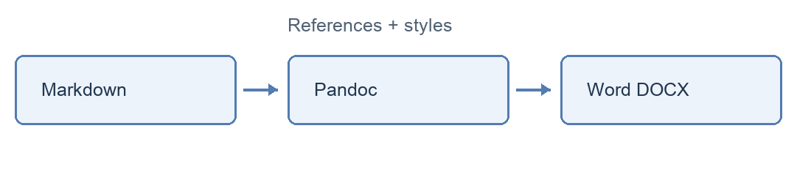

# 写作与导出

Markdown 保存论文的结构与内容，Word 文档用于审阅、修改和提交。本文验证中文段落、引文、公式、图片、表格和脚注能否进入同一个可编辑文档。Pandoc 提供了从 Markdown 到 Word 的转换能力 [@zotero-user-PANDOC01]。

写作过程中，引用与 Zotero 条目保持关联；导出时根据选定的引文样式生成正文引文和参考文献表。修改正文或调整文献元数据后，重新导出即可获得新版本。[^workflow]

[^workflow]: 本次工作流在 Markdown 中维护原稿，导出的 Word 引文为静态文本。

# 公式与结果

行内公式 $E = mc^2$ 与段落文字共同排版。独立公式用于表达计算过程：

$$
\int_0^1 x^2\,dx = \frac{1}{3}
$$

| 内容     | 源文件中的表示    | Word 中的预期            |
| :------- | :---------------- | :----------------------- |
| 章节     | Markdown 标题     | 可编辑的标题样式         |
| 公式     | LaTeX 数学表达式  | Word 原生公式            |
| 参考文献 | Zotero 稳定引用键 | 按样式排版的引文与文献表 |

# 图片与来源

下图表示原稿、文献元数据与样式模板共同参与转换的过程。图片使用编辑器已支持的 HTML 图片写法，以检查这类图片不会在转换中遗漏。

# 小结

导出文件保留正文结构和可编辑内容。视觉格式由 Word 样式模板控制，正文无需写入字体和页边距等排版细节。最终仍应在 Word 中核对期刊或学校要求，特别是复杂表格、图表编号和分节排版。
